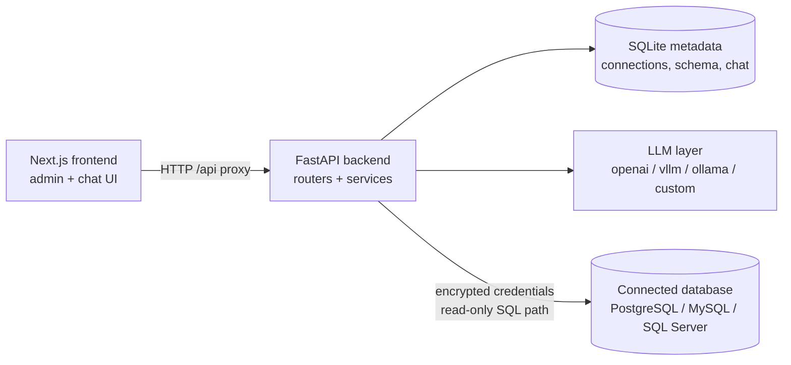
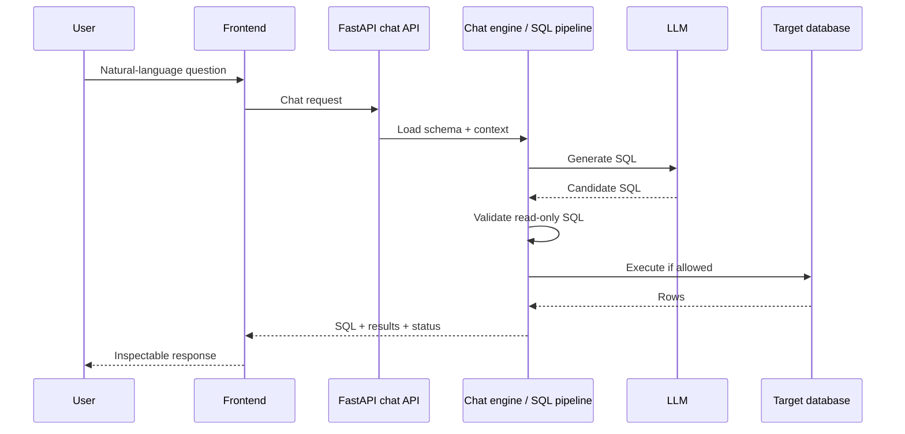

<div align="center">

# Chat2DB

**Ask questions about your data in natural language — explore AI-assisted SQL with schema context.**

Chat2DB is an experimental open-source project that explores how a FastAPI backend, a Next.js admin UI, and pluggable LLM providers can turn natural-language questions into inspectable SQL against connected databases.

[Quick Start](#quick-start) · [Features](#at-a-glance) · [Architecture](#architecture) · [Contributing](#contributing) · [Security](#security-and-limitations)

[](LICENSE)
[](https://github.com/majidmosadegh/chat2db/actions/workflows/ci.yml)
[](.github/workflows/ci.yml)
[](frontend/package.json)
[](#security-and-limitations)

</div>

> **Experimental.** Chat2DB has not been independently audited or verified as production-ready. Capabilities below describe what exists in the repository today. Validate them in your environment before trusting any query path. Prefer least-privilege, preferably read-only, database credentials.

---

## Why Chat2DB?

Many people know the question they want to ask of their data, but not the SQL to express it. Chat2DB explores a practical loop:

1. Keep database schema and related context available to an LLM.
2. Generate SQL from a natural-language question.
3. Keep that SQL visible and subject to read-only validation before execution.

The project did not start with LangChain as its core architecture. That history is intentional: the codebase is open to redesign where real requirements justify it. The original creator has limited time to lead day-to-day development, so contributors and potential co-maintainers can meaningfully shape direction, quality, and ownership of subsystems.

---

## At a glance

| Area | Status | What exists in the repo |
| --- | --- | --- |
| Natural-language chat UI | Experimental | `/chat` UI with bots, sessions, and SQL/result display |
| AI-assisted SQL generation | Experimental | Chat engine + SQL pipeline using schema and related context |
| Schema snapshots | Implemented (code) | Capture/explore schema via frontend `/schema` and backend APIs |
| Data dictionary & relationships | Experimental | Admin workflows under `/data-dictionary` and `/relationships` |
| Use cases & smart builder | Experimental | `/use-cases`, `/smart-use-case-builder`, `/prompt-generator` |
| LLM providers | Implemented (code) | Provider modules for OpenAI-compatible, vLLM, Ollama, custom HTTP |
| DB connectors | Implemented (code) | PostgreSQL, MySQL, SQL Server connection and query paths |
| Read-only SQL guards | Implemented (code) | Validation before execution in connector / chat paths |
| Multi-user auth / AuthZ | Not implemented | No production-grade end-user authentication model |
| Full automated test suite | Partial | CI gates security tests, Gitleaks, and frontend build |

Labels mean:

- **Implemented (code)** — corresponding modules and UI routes exist in this repository.
- **Experimental** — present and wired, but not independently verified end-to-end for every provider/database combination.
- **Partial / Not implemented** — limited coverage or absent by design today.

---

## Example workflow

Intended path through the current application (validate locally):

| Step | Action | Notes |
| ---: | --- | --- |
| 1 | Configure an LLM under **Model Settings** (`/models`) | Providers implemented in code: `openai`, `vllm`, `ollama`, `custom` |
| 2 | Add a database connection (`/database`) | UI options: PostgreSQL, MySQL, SQL Server |
| 3 | Capture / explore a schema snapshot (`/schema`) | Context used by chat and related tools |
| 4 | Optionally enrich dictionary, relationships, use cases | Improves context quality; still experimental |
| 5 | Ask a question in **Chat Assistant** (`/chat`) | Review generated SQL before relying on results |
| 6 | Execution runs only after read-only validation | Destructive SQL is rejected by guards; AI output remains untrusted |

AI-generated SQL is **not** automatically safe. Inspect it. Use least-privilege credentials. Do not point Chat2DB at production databases until you have reviewed the security model yourself.

---

## Compatibility matrix

| Area | Current status | Notes |
| --- | --- | --- |
| Frontend | Next.js 16 / React 19 admin UI | Routes under `frontend/app/*`; some nav items marked coming soon |
| Backend | FastAPI (`backend/`) | Default bind `127.0.0.1:8000` |
| Metadata store | SQLite (local) | Path configurable via `DATABASE_PATH` |
| LLM: OpenAI-compatible | Code present | Configure via Models UI / registry |
| LLM: vLLM | Code present | Same |
| LLM: Ollama | Code present | Same |
| LLM: custom HTTP | Code present | OpenAI-compatible response shape assumed by default |
| DB: PostgreSQL | Code present | Connector + UI option |
| DB: MySQL | Code present | Connector + UI option |
| DB: SQL Server | Code present | Connector + UI option; may need ODBC/driver setup on the host |
| Schema context | Code present | Loaded into chat pipeline |
| AuthN / AuthZ | Immature | Not suitable for untrusted multi-user exposure |
| CI | Active | Security pytest + Gitleaks + frontend build ([workflow](.github/workflows/ci.yml)) |

---

## Architecture

High-level components as they exist in this repository:



**Responsibilities**

- **Frontend** — configuration UI (models, connections, schema, dictionary, relationships, use cases) and chat experience.
- **Backend** — FastAPI application factory, domain APIs, chat engine, encryption for stored secrets.
- **LLM layer** — `backend/llm` provider abstraction and registry (`openai`, `vllm`, `ollama`, `custom`).
- **Connectors** — database access with decryption of stored credentials and read-only SQL validation.
- **Metadata DB** — local SQLite for app configuration and chat/session data (not your analytics warehouse).

Representative chat request flow:



> **Screenshot follow-up.** No checked-in product screenshots are present in this repository yet. A safe, credential-free capture of `/chat` and `/database` would be a welcome contribution under something like `docs/assets/`.

---

## Quick Start

### Prerequisites

| Tool | Reference in repo |
| --- | --- |
| Git | — |
| Python | CI uses **3.12** ([`.github/workflows/ci.yml`](.github/workflows/ci.yml)); local 3.11+ is a reasonable starting point—confirm against `backend/requirements.txt` |
| Node.js | CI uses **20**; frontend depends on **Next.js 16** ([`frontend/package.json`](frontend/package.json)) |
| LLM endpoint | Hosted API key and/or local Ollama/vLLM as you prefer |
| DB drivers | PostgreSQL/MySQL via pip deps; SQL Server may need host ODBC/driver support |

### 1. Clone

```bash
git clone https://github.com/majidmosadegh/chat2db.git
cd chat2db
```

### 2. Configure environment

Copy the examples (never commit real secrets):

```bash
cp .env.example .env
cp frontend/.env.example frontend/.env.local
```

**PowerShell:**

```powershell
Copy-Item .env.example .env
Copy-Item frontend\.env.example frontend\.env.local
```

Generate a Fernet key and set `CHAT2DB_ENCRYPTION_KEY` in `.env` (or your shell):

```bash
python -c "from cryptography.fernet import Fernet; print(Fernet.generate_key().decode())"
```

See [Configuration and encryption](#configuration-and-encryption) and [`docs/ENCRYPTION_KEY.md`](docs/ENCRYPTION_KEY.md).

### 3. Backend

```bash
cd backend
python -m venv .venv
```

Activate the virtualenv:

```bash
# macOS / Linux
source .venv/bin/activate
```

```powershell
# Windows PowerShell
.\.venv\Scripts\Activate.ps1
```

```bash
pip install -r requirements.txt
# CHAT2DB_ENCRYPTION_KEY must be set (from .env or the environment)
python main.py
```

Expected default: `http://127.0.0.1:8000` (`HOST`/`PORT` in [`.env.example`](.env.example)).

### 4. Frontend

In a second terminal:

```bash
cd frontend
npm ci
npm run dev
```

Expected default: `http://localhost:3000`, proxying `/api/*` to the backend ([`frontend/next.config.js`](frontend/next.config.js)).

### Common setup issues

| Symptom | What to check |
| --- | --- |
| Backend exits immediately | `CHAT2DB_ENCRYPTION_KEY` missing or not a valid Fernet key |
| Frontend cannot reach API | `NEXT_PUBLIC_BACKEND_URL` / `NEXT_PUBLIC_API_BASE_URL` in `frontend/.env.local` |
| SQL Server connection fails | ODBC Driver / platform dependencies on the host |
| CORS errors | `CORS_ORIGINS` includes your frontend origin |

Windows users also have `start.bat` for a combined local start script; treat it as convenience tooling and still verify env vars yourself.

> **Verification note.** Security tests and the frontend production build are exercised in CI. A full interactive walkthrough (live LLM + live database) is environment-specific and should be confirmed on your machine.

---

## Configuration and encryption

| File | Purpose |
| --- | --- |
| [`.env.example`](.env.example) | Backend placeholders: `CHAT2DB_ENCRYPTION_KEY`, `HOST`, `PORT`, `CORS_ORIGINS`, optional `DATABASE_PATH` |
| [`frontend/.env.example`](frontend/.env.example) | `NEXT_PUBLIC_BACKEND_URL`, `NEXT_PUBLIC_API_BASE_URL` |

Stored database passwords and LLM API keys are encrypted with Fernet using `CHAT2DB_ENCRYPTION_KEY`. The process fails closed if the key is missing or invalid.

**Rotation:** changing the key makes previously encrypted values unreadable. There is no silent re-encryption migration—re-enter credentials under the new key. Details: [`docs/ENCRYPTION_KEY.md`](docs/ENCRYPTION_KEY.md).

Never commit `.env`, `.env.local`, key files, dumps, or logs.

---

## Testing and CI

CI workflow: [`.github/workflows/ci.yml`](.github/workflows/ci.yml)

| Check | Command / job |
| --- | --- |
| Backend security tests | `pytest tests/security -q` (with `CHAT2DB_ENCRYPTION_KEY` set) |
| Secret scan | Gitleaks on full git history |
| Frontend build | `npm ci` + `npm run build` in `frontend/` |

Local equivalents:

```bash
# Backend security tests
cd backend
pip install -r requirements.txt pytest
export CHAT2DB_ENCRYPTION_KEY="$(python -c 'from cryptography.fernet import Fernet; print(Fernet.generate_key().decode())')"
pytest tests/security -q
```

```powershell
# PowerShell
cd backend
pip install -r requirements.txt pytest
$env:CHAT2DB_ENCRYPTION_KEY = python -c "from cryptography.fernet import Fernet; print(Fernet.generate_key().decode())"
pytest tests/security -q
```

```bash
cd frontend
npm ci
npm run build
```

Many older files under `backend/tests/` are exploratory and are **not** the release gate. Do not assume the full historical suite is green.

---

## Roadmap and good first contributions

These are verified gaps and productive starting points—not promises and not existing issue numbers (the tracker is open for new work):

1. **Reproducible setup** — cross-platform smoke docs; confirm SQL Server driver notes per OS.
2. **Integration tests** — chat pipeline, connector matrix, encryption fail-closed paths beyond the current security tests.
3. **SQL safety** — harden guards, clarify permission boundaries, document threat model.
4. **Connector reliability** — timeouts, clearer errors, connection pooling behavior.
5. **LLM provider UX** — configuration validation, better failure messages, provider capability docs.
6. **Product screenshots** — safe captures for this README (`docs/assets/`).
7. **UX / error handling** — empty states, API error consistency, coming-soon nav cleanup.
8. **Maintainer succession** — subsystem ownership (chat engine, connectors, frontend shell, security).

Suggested issue titles to open if you start one of these:

- “Add credential-free screenshots for README (`/chat`, `/database`)”
- “Document SQL Server ODBC prerequisites per OS”
- “Add integration test: chat rejects destructive SQL”
- “Clarify provider setup matrix (OpenAI / Ollama / vLLM / custom)”

---

## Why contribute?

Chat2DB is a concrete place to work on NL→SQL systems, database tooling, and LLM integration without being locked into a single framework narrative.

We especially welcome:

- **Backend / FastAPI** engineers
- **Frontend / Next.js** engineers
- **AI / LLM** engineers interested in tool use and evaluation
- **Database** specialists (PostgreSQL, MySQL, SQL Server)
- **Security** reviewers
- **Technical writers**
- **Potential long-term maintainers** for a subsystem or the project as a whole

The creator currently has limited time for active day-to-day leadership. That is an opportunity: focused contributors can influence architecture, roadmap, and maintainership through discussion and high-quality pull requests—not through gatekeeping.

---

## Contributing

1. Read [`CONTRIBUTING.md`](CONTRIBUTING.md).
2. Browse [Issues](https://github.com/majidmosadegh/chat2db/issues) (or open a focused new one).
3. Pick a small, well-scoped task.
4. Reproduce the problem or confirm the requirement against current `main`.
5. Add or update tests where they apply (security and build gates are the minimum bar in CI).
6. Open a pull request that states what you changed and how you verified it.

For substantial design changes, start with an issue so others can weigh in.

---

## Security and limitations

**Do not connect Chat2DB to production or sensitive databases until you have reviewed the code and threat model yourself.**

- AI-generated SQL is untrusted input—even when read-only guards are present.
- Use least-privilege credentials; prefer read-only database users for exploration.
- There is no complete multi-user authentication/authorization model for internet exposure.
- Treat any encryption material that may have appeared in older Git history as compromised; rotate keys and re-enter secrets ([`docs/ENCRYPTION_KEY.md`](docs/ENCRYPTION_KEY.md)).

Report vulnerabilities privately via [`SECURITY.md`](SECURITY.md)—do not file public issues with exploit details.

---

## License

Released under the [MIT License](LICENSE).  
Copyright (c) 2026 Majid Mosadeq.

---

<div align="center">

[Repository](https://github.com/majidmosadegh/chat2db) ·
[Issues](https://github.com/majidmosadegh/chat2db/issues) ·
[Contributing](CONTRIBUTING.md) ·
[Security](SECURITY.md) ·
[License](LICENSE)

</div>
