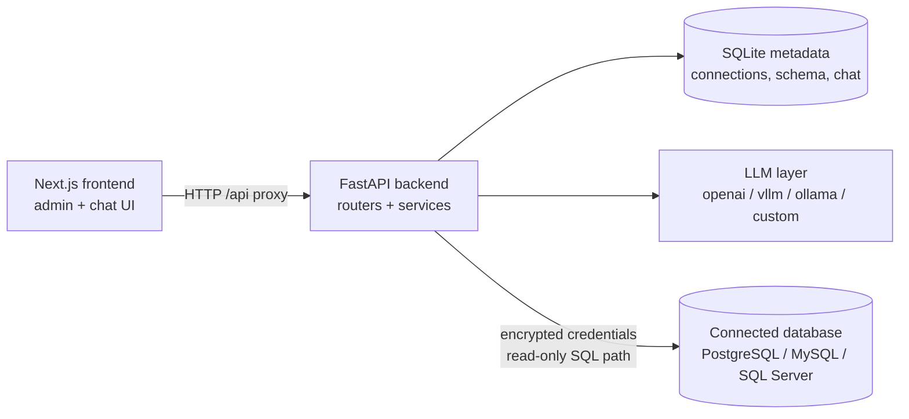
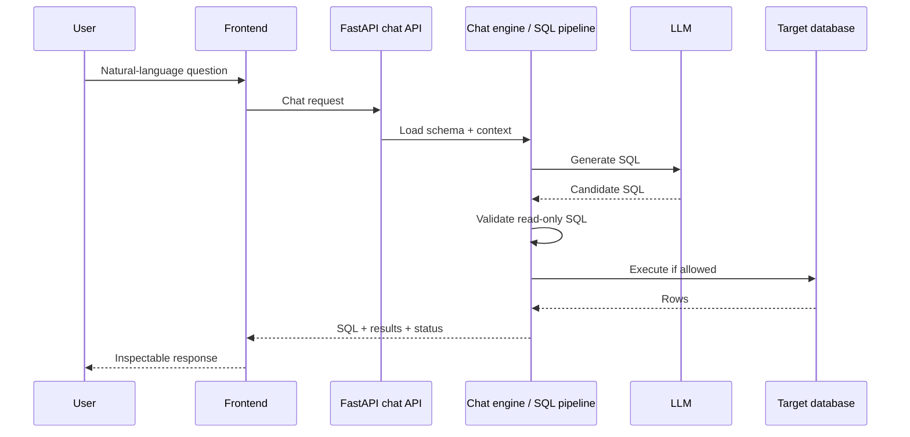

<div align="center">

# Chat2DB

### Open-source AI database assistant for natural-language-to-SQL

**Chat with your database using LLMs — generate inspectable SQL, explore schema context, and help shape the next agentic architecture.**

Chat2DB is an experimental open-source project for developers who want an **AI-powered SQL assistant** and **LLM-powered database client** workflow: connect a database, ask questions in natural language, review generated SQL, and execute only within read-only safety guards.

[Quick Start](#quick-start) · [Features](#features-at-a-glance) · [Agentic vision](#agentic-ai-architecture-next-phase) · [Databases](#database-support-and-expansion) · [Contributing](#contributing) · [Security](#security-and-limitations)

[](LICENSE)
[](https://github.com/majidmosadegh/chat2db/actions/workflows/ci.yml)
[](.github/workflows/ci.yml)
[](frontend/package.json)
[](#security-and-limitations)

</div>

> **Experimental.** Chat2DB has not been independently audited or verified as production-ready. Sections below distinguish **what exists in the repository today** from **planned / evaluation work**. Prefer least-privilege, preferably read-only, database credentials.

---

## Why Chat2DB?

Developers and analysts often know the question they want to ask of their data, but not the SQL. Chat2DB explores a practical **natural-language-to-SQL** loop:

1. Keep schema and related context available to an LLM.
2. Generate SQL from a natural-language question.
3. Keep that SQL visible and subject to read-only validation before execution.

The product name stays **Chat2DB**. The descriptor above is intentional SEO- and developer-facing positioning: *open-source AI database assistant*, *AI SQL assistant*, and *LLM-powered database exploration*—without renaming the repository.

The project did **not** start on LangChain. That earlier custom architecture is still what runs today. The next phase is an open evaluation of modern **agentic AI for databases** (planning, tools, orchestration, human-in-the-loop). Contributors can influence whether and how that migration happens.

The original creator has limited time for day-to-day leadership. Focused collaborators and potential co-maintainers are welcome to own subsystems and help set technical direction.

---

## Features at a glance

| Capability | Status | In the repository today |
| --- | --- | --- |
| Natural-language database chat | Experimental | `/chat` UI with bots, sessions, SQL + results |
| AI-assisted SQL generation | Experimental | Chat engine + SQL pipeline with schema context |
| Schema snapshots & exploration | Implemented (code) | `/schema` + backend APIs |
| Data dictionary & relationships | Experimental | `/data-dictionary`, `/relationships` |
| Use cases & prompt tools | Experimental | `/use-cases`, `/smart-use-case-builder`, `/prompt-generator` |
| LLM provider integrations | Implemented (code) | OpenAI-compatible, vLLM, Ollama, custom HTTP |
| Database connectors | Implemented (code) | PostgreSQL, MySQL, SQL Server (see [matrix](#database-support-and-expansion)) |
| Read-only SQL guards | Implemented (code) | Validation before execution on connector / chat paths |
| Agentic orchestration (LangGraph, etc.) | Planned / evaluation | See [vision doc](docs/vision/agentic-architecture.md) |
| Multi-user auth / AuthZ | Not implemented | Not suitable for untrusted multi-tenant exposure |
| Automated test coverage | Partial | CI: security tests, Gitleaks, frontend build |

**Status legend:** *Implemented (code)* = modules/UI exist · *Experimental* = wired but not independently verified for every provider/DB · *Planned / evaluation* = direction, not shipped · *Partial / Not implemented* = limited or absent.

---

## Natural-language-to-SQL workflow

Intended path through the **current** application (validate locally):

| Step | Action | Notes |
| ---: | --- | --- |
| 1 | Configure an LLM under **Model Settings** (`/models`) | Providers in code: `openai`, `vllm`, `ollama`, `custom` |
| 2 | Add a database connection (`/database`) | UI options today: PostgreSQL, MySQL, SQL Server |
| 3 | Capture / explore a schema snapshot (`/schema`) | Context for generation |
| 4 | Optionally enrich dictionary, relationships, use cases | Improves context; still experimental |
| 5 | Ask a question in **Chat Assistant** (`/chat`) | Review generated SQL before trusting results |
| 6 | Execution runs only after read-only validation | Destructive SQL is rejected by guards; AI output remains untrusted |

AI-generated SQL is **not** automatically safe. Inspect it. Use least-privilege credentials. Do not point Chat2DB at production databases until you have reviewed the security model yourself.

---

## Compatibility matrix (today)

| Area | Current status | Notes |
| --- | --- | --- |
| Frontend | Next.js 16 / React 19 admin UI | Routes under `frontend/app/*`; some nav items marked coming soon |
| Backend | FastAPI (`backend/`) | Default bind `127.0.0.1:8000` |
| Metadata store | SQLite (local) | App config/chat metadata via `DATABASE_PATH` — not your warehouse |
| LLM providers | Code present | OpenAI-compatible, vLLM, Ollama, custom HTTP |
| AuthN / AuthZ | Immature | No production multi-user model |
| CI | Active | Security pytest + Gitleaks + frontend build ([workflow](.github/workflows/ci.yml)) |

---

## Agentic AI architecture (next phase)

Chat2DB’s **running** stack is a custom LLM application: provider registry, chat engine, multi-stage SQL pipeline, and safety validators. That is useful—and also a starting point, not the end state.

The project is exploring a more modern **agentic** design for database work:

- Schema exploration and query planning as explicit steps
- SQL generation, validation, execution feedback, and iterative refinement
- Clear separation of **reasoning/planning**, **workflow orchestration**, **tool execution**, **SQL safety / DB permissions**, and **auditability**
- Human-in-the-loop controls where actions should not be fully autonomous

**Evaluation candidates** (not adoption commitments):

| Candidate | Role in the conversation |
| --- | --- |
| [LangChain](https://github.com/langchain-ai/langchain) | Model and tool integration patterns |
| [LangGraph](https://github.com/langchain-ai/langgraph) | Stateful workflows, checkpoints, controlled orchestration, HITL |
| [Hermes Agent](https://github.com/NousResearch/hermes-agent) (Nous Research) | Alternative agent runtime to evaluate for fit vs. a focused database assistant |
| Other frameworks | Welcome when accompanied by a written evaluation against Chat2DB goals |

No framework will be added “for the README.” Prototypes should earn their place with safety parity, operability, and maintainership.

Deep dive, open questions, and suggested migration stages:  
**[`docs/vision/agentic-architecture.md`](docs/vision/agentic-architecture.md)**

---

## Database support and expansion

Expanding database support is a **planned** part of Chat2DB’s evolution. Presence in a UI dropdown or `if/elif` branch means **code exists**, not that CI verified a live engine.

### Implemented (code present)

| Database | Surfaces | Tested status |
| --- | --- | --- |
| PostgreSQL | Connector, engine factory, `/database` UI | Not exercised against a live Postgres in CI |
| MySQL | Same | Not exercised against a live MySQL in CI |
| SQL Server | Same (+ pymssql/aioodbc paths) | Host ODBC/drivers often required; not in CI live suite |

### Planned (to evaluate)

Illustrative backlog—no count targets or release dates:

- SQLite, MariaDB, Oracle Database, Snowflake, BigQuery, DuckDB, and other engines requested by contributors

### Community proposals

Propose a database when you can describe demand, driver feasibility, and who will maintain tests. Contribution contract:

**[`docs/contributing/database-connectors.md`](docs/contributing/database-connectors.md)**

---

## Architecture (current system)

Components as they exist **today**:



Representative **current** chat request flow:



> **Screenshot follow-up.** No checked-in product screenshots are in the repository yet. A credential-free capture of `/chat` and `/database` under `docs/assets/` would be a welcome contribution.

---

## Quick Start

### Prerequisites

| Tool | Reference in repo |
| --- | --- |
| Git | — |
| Python | CI uses **3.12** ([`.github/workflows/ci.yml`](.github/workflows/ci.yml)); confirm locally against `backend/requirements.txt` |
| Node.js | CI uses **20**; frontend uses **Next.js 16** ([`frontend/package.json`](frontend/package.json)) |
| LLM endpoint | Hosted API and/or local Ollama/vLLM |
| DB drivers | Pip deps for PG/MySQL; SQL Server may need host ODBC/drivers |

### 1. Clone

```bash
git clone https://github.com/majidmosadegh/chat2db.git
cd chat2db
```

### 2. Configure environment

```bash
cp .env.example .env
cp frontend/.env.example frontend/.env.local
```

**PowerShell:**

```powershell
Copy-Item .env.example .env
Copy-Item frontend\.env.example frontend\.env.local
```

Generate a Fernet key and set `CHAT2DB_ENCRYPTION_KEY` in `.env` (or your shell):

```bash
python -c "from cryptography.fernet import Fernet; print(Fernet.generate_key().decode())"
```

See [Configuration and encryption](#configuration-and-encryption) and [`docs/ENCRYPTION_KEY.md`](docs/ENCRYPTION_KEY.md).

### 3. Backend

```bash
cd backend
python -m venv .venv
```

```bash
# macOS / Linux
source .venv/bin/activate
```

```powershell
# Windows PowerShell
.\.venv\Scripts\Activate.ps1
```

```bash
pip install -r requirements.txt
# CHAT2DB_ENCRYPTION_KEY must be set
python main.py
```

Expected default: `http://127.0.0.1:8000`.

### 4. Frontend

```bash
cd frontend
npm ci
npm run dev
```

Expected default: `http://localhost:3000` (proxies `/api/*` via [`frontend/next.config.js`](frontend/next.config.js)).

### Common setup issues

| Symptom | What to check |
| --- | --- |
| Backend exits immediately | `CHAT2DB_ENCRYPTION_KEY` missing or invalid Fernet key |
| Frontend cannot reach API | `NEXT_PUBLIC_BACKEND_URL` / `NEXT_PUBLIC_API_BASE_URL` |
| SQL Server connection fails | ODBC Driver / platform dependencies |
| CORS errors | `CORS_ORIGINS` includes your frontend origin |

Windows: `start.bat` is convenience tooling—still verify env vars yourself.

> Security tests and the frontend production build run in CI. A full interactive walkthrough (live LLM + live database) is environment-specific.

---

## Configuration and encryption

| File | Purpose |
| --- | --- |
| [`.env.example`](.env.example) | `CHAT2DB_ENCRYPTION_KEY`, `HOST`, `PORT`, `CORS_ORIGINS`, optional `DATABASE_PATH` |
| [`frontend/.env.example`](frontend/.env.example) | `NEXT_PUBLIC_BACKEND_URL`, `NEXT_PUBLIC_API_BASE_URL` |

Stored database passwords and LLM API keys use Fernet via `CHAT2DB_ENCRYPTION_KEY` (fail closed if missing/invalid). Rotating the key requires credential re-entry—see [`docs/ENCRYPTION_KEY.md`](docs/ENCRYPTION_KEY.md).

Never commit `.env`, `.env.local`, key files, dumps, or logs.

---

## Testing and CI

Workflow: [`.github/workflows/ci.yml`](.github/workflows/ci.yml)

| Check | Command / job |
| --- | --- |
| Backend security tests | `pytest tests/security -q` (with `CHAT2DB_ENCRYPTION_KEY`) |
| Secret scan | Gitleaks on git history |
| Frontend build | `npm ci` && `npm run build` in `frontend/` |

```bash
cd backend
pip install -r requirements.txt pytest
export CHAT2DB_ENCRYPTION_KEY="$(python -c 'from cryptography.fernet import Fernet; print(Fernet.generate_key().decode())')"
pytest tests/security -q
```

```powershell
cd backend
pip install -r requirements.txt pytest
$env:CHAT2DB_ENCRYPTION_KEY = python -c "from cryptography.fernet import Fernet; print(Fernet.generate_key().decode())"
pytest tests/security -q
```

```bash
cd frontend
npm ci
npm run build
```

Many files under `backend/tests/` are exploratory and are **not** the release gate.

---

## Roadmap and good first contributions

Verified gaps and productive starting points (not dated commitments; open issues as you start work):

1. **Agentic architecture spikes** — tool contracts, LangGraph/Hermes/LangChain evaluations with safety parity ([vision](docs/vision/agentic-architecture.md)).
2. **Database adapters** — new engines, cleaner adapter interface, live integration tests ([connector guide](docs/contributing/database-connectors.md)).
3. **SQL safety & permissions** — stronger guards, threat-model docs, HITL approve-before-execute UX.
4. **Reliability & observability** — structured traces for generation/tool steps, clearer connector errors.
5. **Reproducible setup** — cross-platform smoke docs; SQL Server driver notes per OS.
6. **Product screenshots** — safe captures for this README (`docs/assets/`).
7. **Maintainer succession** — ownership for chat engine, connectors, frontend shell, security.

Suggested issue titles:

- “Spike: LangGraph workflow behind a feature flag with SQL safety parity”
- “Add SQLite connector for local demos”
- “Document SQL Server ODBC prerequisites per OS”
- “Integration test: chat rejects destructive SQL”
- “Add credential-free screenshots for README (`/chat`, `/database`)”

---

## Why contribute?

Chat2DB is a place to work on **open-source AI SQL assistants**, **natural-language-to-SQL**, **database connector architecture**, and **agentic AI for databases**—and to help decide the stack, not only implement a predetermined one.

Especially welcome:

- Engineers exploring **LangChain / LangGraph / agent frameworks** with clear evaluation criteria
- **Database** specialists (connectors, drivers, warehouses)
- **Security** reviewers (SQL safety, credentials, AuthZ)
- **Backend (FastAPI)** and **frontend (Next.js)** engineers
- **Technical writers** and **potential long-term maintainers**

You can shape product direction and technical design through issues, design notes, and high-quality PRs. Limited creator bandwidth means committed collaborators can take real ownership.

---

## Contributing

1. Read [`CONTRIBUTING.md`](CONTRIBUTING.md).
2. Browse [Issues](https://github.com/majidmosadegh/chat2db/issues) or open a focused new one.
3. For architecture or new databases, start from:
   - [`docs/vision/agentic-architecture.md`](docs/vision/agentic-architecture.md)
   - [`docs/contributing/database-connectors.md`](docs/contributing/database-connectors.md)
4. Reproduce the problem or confirm the requirement against current `main`.
5. Add or update tests where they apply (CI security + build gates are the minimum bar).
6. Open a pull request that states what you changed and how you verified it.

---

## Security and limitations

**Do not connect Chat2DB to production or sensitive databases until you have reviewed the code and threat model yourself.**

- AI-generated SQL is untrusted—even with read-only guards.
- Use least-privilege credentials; prefer read-only database users for exploration.
- There is no complete multi-user authentication/authorization model for internet exposure.
- Treat any encryption material that may have appeared in older Git history as compromised; rotate keys and re-enter secrets ([`docs/ENCRYPTION_KEY.md`](docs/ENCRYPTION_KEY.md)).

Report vulnerabilities privately via [`SECURITY.md`](SECURITY.md).

---

## License

Released under the [MIT License](LICENSE).  
Copyright (c) 2026 Majid Mosadeq.

---

<div align="center">

[Repository](https://github.com/majidmosadegh/chat2db) ·
[Issues](https://github.com/majidmosadegh/chat2db/issues) ·
[Contributing](CONTRIBUTING.md) ·
[Agentic vision](docs/vision/agentic-architecture.md) ·
[Database connectors](docs/contributing/database-connectors.md) ·
[Security](SECURITY.md) ·
[License](LICENSE)

</div>
